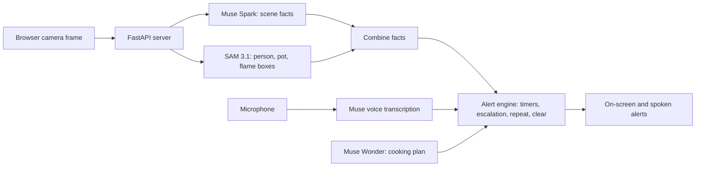

# Mpishi

**An extra set of eyes on your stove.**

Mpishi (Kiswahili for "cook") is an AI kitchen safety assistant. A camera watches the cooking area, two Meta models work out what is happening, and Mpishi speaks up only when the cook needs to know something. It works in English and Kiswahili.

> Mpishi is **not** a smoke alarm and **not** a replacement for watching hot oil. It is an extra layer of attention, not a guarantee.

**Live demo:** https://mpishi-2o9y.onrender.com/

---

## Why I built it

- Elderly people deserve to keep cooking independently, with a quiet safety net behind them.
- Busy parents who are multitasking should be able to step away from the stove without constant worry.
- Unattended cooking is a common cause of kitchen fires, and most of those fires are preventable.
- It was also a way to push camera-based, AI-driven Internet of Things (IoT) monitoring further.

Mpishi was built for a Meta hackathon, using Meta's Muse Spark, SAM 3.1 and realtime voice models.

---

## What it does

- **Silent by default.** It does not narrate the cook. It speaks only for safety conditions, cooking checkpoints and direct questions.
- **Unattended-stove alerts.** If a burner looks lit and nobody is near it, Mpishi raises an alert at 5, 10, 20 and 30 minutes. Alerts are worded as warnings, repeat every minute (up to four times) until acknowledged, and clear automatically when someone returns or the burner goes off.
- **Live object boxes.** SAM 3.1 draws boxes with confidence scores over the video: green for **person**, blue for **pot**, orange for **flame**.
- **Cooking guide per item.** Muse Wonder, with web search, plans each dish with estimated checkpoints. Each item has its own clock, and up to 8 items can run at once.
- **Voice control.** Tap to talk, or turn on hands-free mode and say "Mpishi, set a timer for five minutes." You can also add items, ask questions ("is it ready yet?") and acknowledge alerts by voice.
- **Honest failure.** If the camera or connection stops, a red "MPISHI IS NOT WATCHING" banner appears, so you are never falsely reassured.
- **Demo mode.** A checkbox compresses the timers (default 20x: 15, 30, 60 and 90 seconds) and shows a "Demo mode" badge.
- **Replay mode.** You can feed a recorded video to the app instead of a live camera, which is useful for repeatable demos.
- **Cost tracking.** The page shows an estimated cost for the session.

---

## How it works

Every few seconds the browser sends a camera frame to the server. Two models look at the same frame **at the same time**, and their results are combined:

| Model | Job |
|---|---|
| **Muse Spark** (`muse-spark-1.3`) | Understands the whole scene and returns structured facts: is a pan visible, is a person near, is a burner lit, and whether anything needs saying. |
| **SAM 3.1** (`sam-3.1`) | Finds specific objects ("person", "pot", "flame") and returns boxes with confidence scores. |
| **Muse Wonder** (`muse-wonder-1.0`) | Plans each dish, with web search, and produces cooking checkpoints. |
| **Muse voice transcription** (`muse-voice-transcribe-1.0`) | Realtime speech-to-text for tap-to-talk and hands-free mode. |

**Muse understands, SAM proves.**



### How the two models are combined

- A confident SAM "person" box sets *person present*; no box sets it to absent.
- A confident SAM "pot" box confirms a pan is visible, but its absence never forces "no pan".
- A confident SAM "flame" box confirms a lit burner, but its absence never turns a lit burner off. Muse Spark's reading stands unless SAM positively confirms something.
- If SAM is slow or fails, the Muse Spark result is used on its own.
- One odd reading never cancels the stove countdown. Clearing an alert needs two consecutive confirming readings.

### Keeping cost and noise down

- Frames that barely change are skipped (`MPISHI_CHANGE_THRESHOLD`), with a heartbeat check every 45 seconds.
- Each session is capped at 400 model calls and expires after 4 hours.

---

## Getting started

### Requirements

- Python 3.10 or newer
- A Meta Model API key
- A webcam and a modern browser (the camera works only on `localhost` or HTTPS)

### Run locally (Windows PowerShell)

```powershell
python -m venv .venv
.venv\Scripts\python -m pip install -r requirements.txt
copy .env.example .env      # then put your Meta Model API key in .env
.venv\Scripts\python -m uvicorn main:app --port 8000
```

### Run locally (macOS / Linux)

```bash
python3 -m venv .venv
.venv/bin/python -m pip install -r requirements.txt
cp .env.example .env        # then put your Meta Model API key in .env
.venv/bin/python -m uvicorn main:app --port 8000
```

Open http://localhost:8000. To use a phone, open an HTTPS tunnel to port 8000 (for example `cloudflared tunnel --url http://localhost:8000`) and **set `MPISHI_ACCESS_CODE` first**.

### Configuration

Set these in `.env` locally, or as environment variables on your host.

| Variable | Default | Purpose |
|---|---|---|
| `MODEL_API_KEY` | none (**required**) | Your Meta Model API key. |
| `MPISHI_ACCESS_CODE` | empty | If set, every API call and the voice sockets need this code, and the page shows an access-code box. Leave empty for local use. |
| `META_BASE_URL` | `https://api.meta.ai/v1` | API base URL. |
| `MPISHI_MODEL` | `muse-spark-1.3` | Scene-understanding model. |
| `MPISHI_PLAN_MODEL` | `muse-wonder-1.0` | Cooking-plan model. |
| `MPISHI_REASONING` / `MPISHI_PLAN_REASONING` | `minimal` / `low` | Reasoning effort for each model. |
| `MPISHI_SAM` | `1` | Set to `0` to turn SAM off. |
| `MPISHI_SAM_PROMPTS` | `person,pot,flame` | What SAM looks for. Remove `flame` to cut cost. |
| `MPISHI_DEMO_SPEED` | `20` | Timer compression in demo mode. |
| `MPISHI_CHANGE_THRESHOLD` | `4.0` | How much a frame must change to be re-analysed. |
| `MPISHI_HEARTBEAT_SECONDS` | `45` | Maximum gap between analyses on a still scene. |
| `MPISHI_MAX_CALLS` | `400` | Model calls allowed per session. |
| `MPISHI_VOICE_URL` | `wss://api.meta.ai/v1/asr/realtime` | Realtime voice endpoint. |

### Deploy (example: Render)

1. Create a **Web Service** from this repository.
2. Build command: `pip install -r requirements.txt`
3. Start command: `uvicorn main:app --host 0.0.0.0 --port $PORT`
4. Add the environment variables above, at minimum `MODEL_API_KEY`.
5. **Set `MPISHI_ACCESS_CODE` if the site is public**, so strangers cannot spend your credits.

Sessions live in memory, so they are lost when the server restarts, and free hosting sleeps when idle. Demo locally when timing matters.

---

## API overview

| Method | Path | Purpose |
|---|---|---|
| `GET` | `/api/health` | Status, model, and whether an access code is required. |
| `GET` | `/api/selftest` | Checks that the model API key works. |
| `POST` | `/api/session` | Start a session (food, goal, language, demo mode). |
| `POST` | `/api/session/{id}/items` | Add another item to cook. |
| `POST` | `/api/session/{id}/frame` | Send a camera frame (JPEG, under 3 MB) and get facts, boxes and alerts. |
| `POST` | `/api/session/{id}/ask` | Ask a question about the current view. |
| `POST` | `/api/session/{id}/utterance` | Handle a spoken or typed command (timer, add item, acknowledge). |
| `POST` | `/api/session/{id}/ack` | Acknowledge an alert. |
| `GET` | `/api/session/{id}/usage` | Estimated usage and cost for the session. |
| `DELETE` | `/api/session/{id}` | End a session. |
| `WebSocket` | `/ws/voice/{id}` | Tap-to-talk transcription. |
| `WebSocket` | `/ws/listen/{id}` | Hands-free listening with the "Mpishi" wake word. |

If `MPISHI_ACCESS_CODE` is set, send it in the `X-Access-Code` header (or the `code` query parameter for WebSockets).

---

## Project structure

```
main.py            FastAPI server: model calls, SAM, alert engine, voice sockets
static/
  index.html       Single-page front end (camera, overlay, alerts, voice)
  (icons, manifest)
test_core.py       Unit tests
requirements.txt   Python dependencies
.env.example       Example configuration
```

---

## Testing

```powershell
.venv\Scripts\python -m pytest -q
```

The tests cover the response parsers, the unattended-stove timeline and escalation, alert repeat and clearing, demo-mode timing, Kiswahili messages, the voice command parsing, and how SAM results are merged with Muse Spark's.

---

## Privacy and cost

- Camera images are sent to Meta's Muse and SAM models to read the stove. Mpishi keeps only the latest two frames in memory and does not save them.
- When hands-free mode is on, kitchen audio is streamed to Meta's voice model, and only sentences starting with "Mpishi" are acted on.
- Each analysed frame makes one Muse Spark call plus one SAM call per detected object type. The session cost shown in the interface is an estimate from the prices in `main.py`. Check your provider's current pricing.

---

## Known limits

- A camera cannot see inside food, read oil temperature, or reliably see every flame or all smoke. Mpishi says so and asks the cook to check by hand.
- Detection is only as good as the lighting, camera angle and image quality. Blue gas flames may be missed.
- Cooking times are web-sourced estimates for a home stove. Always check by hand or with a thermometer.
- Sessions are held in memory and lost on restart.
- The Kiswahili text has not been reviewed by a native speaker.
- It depends on an internet connection and on Meta's model APIs being available.

---

## Ideas for what comes next

- Test flame detection across more kitchens, lighting conditions and gas and electric stoves.
- Have the Kiswahili messages reviewed by native speakers.
- Add persistent storage and optional alerts to a phone when the cook is away from the screen.
- Reduce the cost per session, for example with fewer SAM calls on still scenes.
- Explore connecting to real hardware, such as smart plugs or gas sensors, alongside the camera.

---

## Author

**Lornah**, Nairobi, Kenya. Full-stack developer (back-end focus) and cybersecurity analyst.
Contact:www.linkedin.com/in/lornahkabuga | lornahkabuga - Discord

